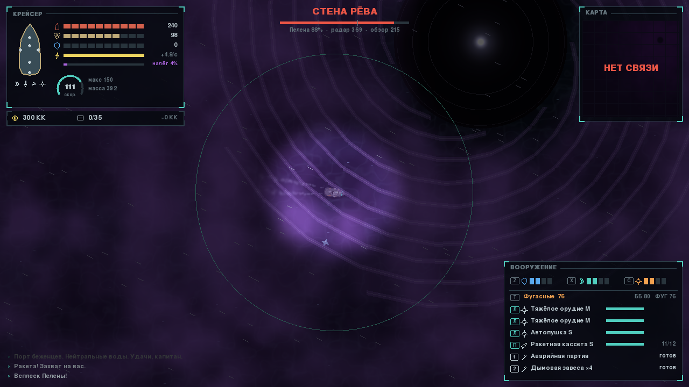
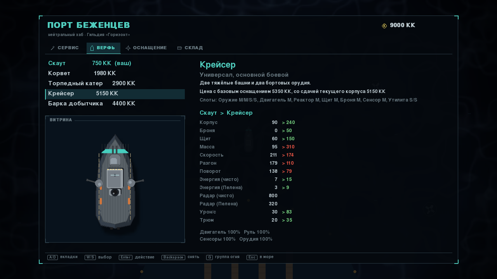
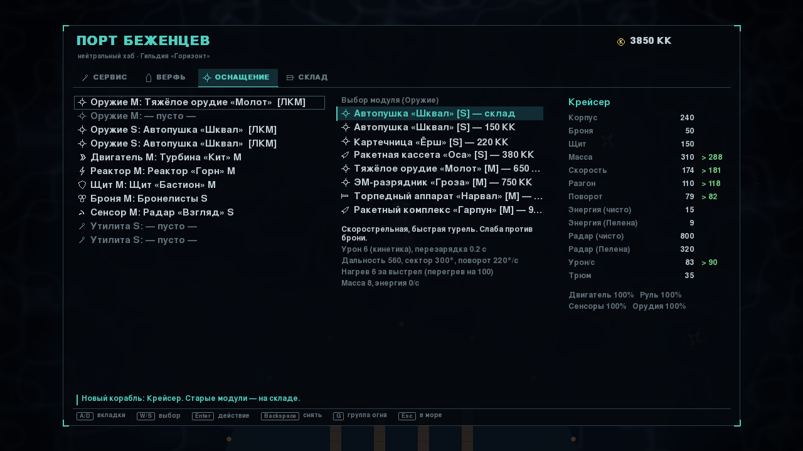
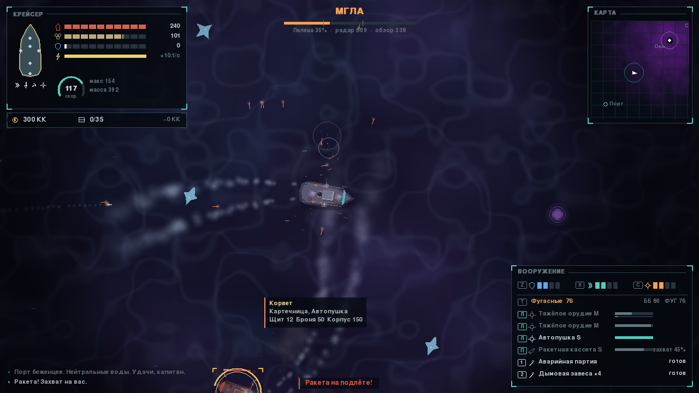

# Девятка — прототип

Одиночный прототип на pygame. Проверяем механики: **Пелену** как единое поле плотности, которое определяет риск, награду и то, что игрок вообще видит, и **корабли**, собранные из корпуса и модулей.

Карта пока — заглушка (один сектор); сейчас в фокусе механики.



## Запуск

```bash
pip install -r requirements.txt
python main.py            # или python main.py --seed 42
python -m pytest          # тесты (без окна)
python tools/duel.py      # матрица дуэлей для баланса кораблей
```

Нужен Python 3.10+, `pygame-ce` (или обычный `pygame` 2.x) и `numpy`.

## Управление

| Клавиша | Действие |
|---|---|
| W / S | ход вперёд / назад |
| A / D | руль |
| Shift | форсаж (тратит энергию) |
| ЛКМ / Пробел | группа огня 1 (по умолчанию пушки); наведите курсор на цель — турели сами возьмут упреждение |
| ПКМ | группа огня 2 (по умолчанию ракеты — держать на цели для захвата, торпеды — по курсу) |
| Z / X / C, V | энергия в щиты / двигатель / орудия, V — поровну |
| T | тип снарядов: стандартные / бронебойные / фугасные |
| 1–4 | активные модули (ремонтный гель, дым, глушилка, Био-экран, аварийная партия) |
| E (удерживать) | добыча у ресурсной точки |
| F | швартовка в порту / выход в море |
| В порту | A/D — вкладки, W/S — выбор, Enter — действие, Backspace — снять модуль, G — группа огня, Esc — выход |
| Колесо мыши | зум камеры |
| H | справка, F12 — скриншот, Esc — выход |

## Что уже есть

- **Графика** — детальная векторная, вся рисуется кодом (`nine/gfx/`). Корабли с палубой, надстройками, тенями и цветами стороны; модули видны на корпусе; повреждения оставляют подпалины. Живой океан с рябью и бликами, клубящиеся космы Пелены там, где она густая, спираль шторма и дождь у Ока, разряды во Всплеске. Частицы: вспышки выстрелов, трассеры, всплески промахов, рябь щита, искры, взрывы, дым пожаров, кильватер. Камера плавно следует, зумится колесом и трясётся от попаданий. Интерфейс в едином стиле «тонкие линии + акцент» с иконками, силуэтом корабля и витриной на верфи.

- **Поле Пелены** (`nine/veil.py`). Плотность растёт от Порта беженцев (юго-запад) к Оку Девятки (северо-восток) и медленно дрейфует («течения аномалии»). Зоны: Чистый слой, Мгла, Плотная Пелена, Пояс Разлома, Стена Рёва, Око / Зеркало.
- **Сенсоры.** Радар и визуальный обзор сжимаются в плотной Пелене. Врагов за пределами обзора видно только как отметки радара, Тиходонтов на радаре не видно вообще.
- **Налёт филаментов.** Быстрый ход, особенно на форсаже, в плотной Пелене обращивает корпус: скорость и тяга падают. Корпус чистят в порту.
- **Мировые события** (`nine/events.py`) описаны данными, как ScriptableObject:
  - *Всплеск Пелены*: плотность растёт, радар слепнет, щиты выгорают. За ~18 с до начала **скаты уходят на глубину**; это единственное предупреждение.
  - *Штиль*: Пелена редеет, точность стрельбы растёт.
- **Тиходонты.** Если стоять под ними тихо, пираты вас не замечают. Шум двигателя злит гиганта, и он таранит сквозь щиты.
- **Рейдеры Ржавого Прилива.** Собраны из тех же модулей: стрелок, громила с картечью, ракетчик, охотник на корвете. Чем гуще Пелена, тем опаснее. У порта их нет.
- **Добыча и экономика.** Соль-металл, Конденсат Пелены, Окаменевшие филаменты, Изотоп «Ноль» (только в Зеркале). Чем плотнее зона, тем дороже ресурс.
- **Корабли** ([дизайн](docs/design/ships.md)). 5 корпусов (Скаут, Корвет, Торпедный катер, Крейсер, Барка) со слотами S/M и 32 модуля. Энергия реактора против потребления модулей, причём электроника в Пелене прожорливее. Масса модулей и груза замедляет корабль. Турели с секторами и скоростью поворота. Пушки, ракеты с захватом цели (Пелена сбивает наведение), торпеды сквозь щиты. Щит → броня → корпус с разными типами урона. Подсистемы выходят из строя. Активные модули. Распределение энергии, группы огня, нагрев орудий, бронебойные и фугасные снаряды, пожары и затопление с креном. Модули видны на корпусе, у цели под курсором — подсказка с её вооружением.
- **Порт.** Сервис (продажа, ремонт, боезапас, чистка), верфь, экран оснащения со сравнением «было > станет», склад модулей и трофеев.
- **Смерть по GDD.** Корабль потерян: половина груза остаётся в обломках, капитан уходит в капсуле, страховка выплачивается по прибытии в порт. Если сбили и капсулу: долг спасателям (пока он не погашен, покупки закрыты) и травма (медленнее перезарядка, меньше радар).
- **Око Девятки.** Гравитация тянет к центру, в Стене Рёва идёт стихийный урон и бывают ЭМ-вспышки, в мёртвой зоне нет миникарты. В центре абсолютный штиль.







## Структура

```
main.py            точка входа
nine/config.py     все числа баланса
nine/veil.py       поле плотности Пелены и зоны
nine/events.py     WorldEventData + EventDirector
nine/hulls.py      каталог корпусов и слотов
nine/modules.py    каталог модулей
nine/ship.py       корабль: сборка из модулей, энергия, масса, физика, урон, подсистемы
nine/combat.py     стрельба, упреждение, ракеты, торпеды
nine/entities.py   ресурсы, лут, дым
nine/ai.py         пираты, Тиходонты, скаты
nine/world.py      симуляция (без pygame-окна, принимает Controls)
nine/render.py     сборка кадра из слоёв
nine/gfx/          графика: camera, palette, ship_art, fx (частицы), ocean (вода, Пелена, погода),
                   objects (порт, ресурсы, фауна), ui (панели, шкалы, иконки)
nine/hud.py        интерфейс в море
nine/port_ui.py    экран порта: сервис, верфь, оснащение, склад
nine/game.py       цикл ввод → симуляция → отрисовка
tools/duel.py      матрица дуэлей для баланса
tests/             pytest: Пелена, события, корабли, бой, порт, смерть, smoke-тест
```

Симуляция (`World`) отделена от ввода и отрисовки. Её можно гонять в тестах и позже перенести логику в Unity.

План разработки: [docs/ROADMAP.md](docs/ROADMAP.md) (вехи до релиза) и [docs/BACKLOG.md](docs/BACKLOG.md) (все задачи по системам).
